 

&nbsp;
&nbsp;
&nbsp;

 

<picture>
  <source media="(prefers-color-scheme: dark)" srcset="./assets/h-about-dark.svg" />
  
</picture>

I'm a machine learning researcher from Dhaka, Bangladesh, developing principled methods for **causal machine learning** and **trustworthy AI**: systems that reason about cause and effect while staying fair, robust, interpretable and reproducible, with applications in criminal justice, environmental governance and healthcare.

I care less about squeezing another point of accuracy out of a model and more about whether its claims **hold up**: does the effect survive a causal test, are the uncertainties calibrated, does the result reproduce on someone else's machine?

I'm a **Research Assistant at the Center for Artificial Intelligence and Robotics (CAIR), Southeast University**, and a CSE graduate of **RUET** (2025, thesis A+). I'm currently looking for a **fully funded Ph.D. position starting Fall 2027**.

  

<picture>
  <source media="(prefers-color-scheme: dark)" srcset="./assets/h-research-focus-dark.svg" />
  
</picture>

  

<picture>
  <source media="(prefers-color-scheme: dark)" srcset="./assets/h-selected-work-dark.svg" />
  
</picture>

Live demos: <a href="https://reproapp-8jb7vbhnqyltxq23bsr8xn.streamlit.app/">ReproHub</a> ·
<a href="https://statistical-analysis-app-7axetqtx75ncuu7fr8irxj.streamlit.app/">StatsPro</a> ·
<a href="https://smart-rag-chatbot-izxizdewwebpsrmhhufyxe.streamlit.app/">Smart RAG Chatbot</a>

 

<picture>
  <source media="(prefers-color-scheme: dark)" srcset="./assets/h-publications-dark.svg" />
  
</picture>

<b>Journal article</b>

 

- **Machine Learning for Crime Classification: A Fairness-Aware Approach to Class Imbalance** 
  S.J. Ahmed, M.H.R. Kwoshik, M.T. Islam Nahian · *Journal of Machine Learning and Applications* 2(1), 9–17 · 2026 · [`DOI`](https://doi.org/10.61577/jmla.2026.100002) 
  Extended version of the IEEE SPICSCON 2026 paper.

<b>Refereed conference papers</b>

 

- **CF-EGAT: A Causal Fairness-Aware Equity Graph Attention Network for Country-Level Environmental Livability Classification** 🏆 
  S.J. Ahmed, M.H.R. Kwoshik, M.T. Islam Nahian · *SPECTRA 2026*, oral · **1st Best Paper Award** · [`DOI`](https://doi.org/10.5281/zenodo.21195761)
- **Multi-Dimensional Statistical Similarity for Governance Classification: Beyond Arbitrary Thresholds in Comparative Politics** 🏆 
  S.J. Ahmed · *APMEE 2025, IEB*, oral · **Best Research Paper Award** · provisionally accepted in the *Journal of EED, IEB*
- **Auditing, Not Predicting: A Causal Bias-Decomposition Framework for Clinical Fairness, and a Cautionary Tale of Representation Collapse in A-ICF** 
  S.J. Ahmed · *IEEE OMLET 2026*, poster · IEEE Xplore
- **Conformal Influence-Driven Realignment (CIDR): A Framework for Restoring Model Reliability under Distribution Shift** 
  S.J. Ahmed · *IEEE CSDE 2026*, presented
- **CalForget: Calibration-Driven Selective Forgetting via Conformal Influence Attribution** 
  S.J. Ahmed · *IEEE CSDE 2026*, presented
- **FAI: Feature-Wise Adaptive Imputation via Downstream-Aware Method Selection** 
  S.J. Ahmed · *ICISET 2026*, oral · ~27% acceptance rate
- **RMA-BO: Regret-Minimizing Adaptive Bayesian Optimization** 
  S.J. Ahmed, M.T. Islam Nahian, M.H.R. Kwoshik · *SPECTRA 2026*, oral · [`DOI`](https://doi.org/10.5281/zenodo.21194394)
- **Environmental Livability Assessment via Adaptive Bootstrap-Retrained SHAP and Statistically-Constrained Pareto Counterfactuals** 
  S.J. Ahmed, M.H.R. Kwoshik, M.F.N. Nakib · *IEEE SPICSCON 2026*, presented · IEEE Xplore
- **Machine Learning for Crime Classification: A Fairness-Aware Approach to Class Imbalance** 
  S.J. Ahmed, M.H.R. Kwoshik, M.F.N. Nakib · *IEEE SPICSCON 2026*, presented · IEEE Xplore
- **DeepEnMap: Ordinal-Aware Multi-Modal Deep Learning for Energy Poverty Risk Mapping** 
  S.J. Ahmed · *IEMIS 2026* · Springer LNNS
- **Density-Decoupled, Mask-Ablated Segmentation-Guided Diffusion for Controllable Mammography Synthesis** 
  S.J. Ahmed · *IEMIS 2026* · Springer LNNS

<b>Conference abstracts</b>

 

- **Identification-Aware Selective Prediction: A Decision-Theoretic Framework for Causal AI Reliability** 
  S.J. Ahmed · *ISRC 2026*, University of Dhaka, oral · ~20% acceptance rate
- **Conformal Influence-Driven Realignment (CIDR): A Framework for Restoring Model Reliability under Distribution Shift** 
  S.J. Ahmed, M.H.R. Kwoshik · *1st National Science Conference 2026*, Barishal University Science Club · Certificate of Appreciation

<b>Book chapter &amp; manuscripts under review</b>

 

- **Generative AI and Mathematical Optimization for Football Match Outcome Prediction** 
  S.J. Ahmed · invited chapter in M. Lahby (ed.), *Generative AI and Mathematical Optimization for Performance and Innovation in Football*, Springer · under review
- **DemocracyGuard: Testing a Divergence-Index Reconciliation of Subjective and Objective Democracy Indicators for Forecasting Adverse Regime Transitions** 
  S.J. Ahmed · *Transactions on Machine Learning Research (TMLR)* · under review
- **Active Neuro-Causal Immunization (ANCI): A Conflict-Neuron Framework for Jointly Auditing Fairness, Robustness, and Privacy in Neural Classifiers** 
  S.J. Ahmed, M.H.R. Kwoshik, M.T. Islam Nahian · *ICRPSET 2026* · under review
- **Identification-Aware Selective Prediction: A Decision-Theoretic Framework for Causal AI Reliability** 
  S.J. Ahmed · *ICEEICT 2027* · under review

 

<picture>
  <source media="(prefers-color-scheme: dark)" srcset="./assets/h-journey-dark.svg" />
  
</picture>

  

<picture>
  <source media="(prefers-color-scheme: dark)" srcset="./assets/h-toolkit-dark.svg" />
  
</picture>

  

<b>Beyond research</b>

 

- 📖 **Published poet**: author of *Sob Odvuture* (*All Adventures*), a Bengali collection of 50+ poems
- 🎙️ **Radio host**: *Suspense with RJ Rupok* on Radio Kothabondhu, and shows on Radio RUET
- 🎵 **Musician**: lyricist, composer and singer of original songs
- 🧑‍🏫 **Mentor**: free tutoring for students from disadvantaged backgrounds since 2019; guided five students to perfect 5.00 GPAs and four into RUET, BUET and CUET
- 🏐 **Leadership**: volleyball captain, parade commander and scout leader at school; Best Speller Award, Pabna Cadet College

Storytelling and statistics turn out to want the same thing: something worth trusting.

 

