<a href="https://junaid-ahmed-rupok.github.io/My-World/"></a>

<p align="center">
<sub>
<a href="https://junaid-ahmed-rupok.github.io/My-World/"><b>PORTFOLIO</b></a> &nbsp;&nbsp;/&nbsp;&nbsp;
<a href="https://www.linkedin.com/in/sarder-junaid-ahmed-059b68240/"><b>LINKEDIN</b></a> &nbsp;&nbsp;/&nbsp;&nbsp;
<a href="mailto:junaidahmedrupok@gmail.com"><b>EMAIL</b></a> &nbsp;&nbsp;/&nbsp;&nbsp;
<a href="#writing"><b>PAPERS</b></a> &nbsp;&nbsp;/&nbsp;&nbsp;
<a href="https://junaid-ahmed-rupok.github.io/1797_Junaid_Portfolio/"><b>RETRO SITE</b></a>
</sub>
</p>

<br/>


Most ML pipelines quietly skip the statistics. I don't.

I work on **causal machine learning** and **trustworthy AI**: models that reason about cause and effect, carry honest uncertainty, treat people fairly, and give the same answer on someone else's machine. Before I believe a claim — a model's accuracy, a policy's effect, a paper's result — it has to survive a hypothesis test.

*Causal inference instead of correlation-shrugging. Calibrated uncertainty instead of point-estimate confidence. Reproducibility instead of "it ran on my machine."*



<br/><br/>


<p align="center">
<a href="https://github.com/Junaid-Ahmed-Rupok/ReproHub"></a>
<a href="https://github.com/Junaid-Ahmed-Rupok/statistical-analysis-app"></a>
<a href="https://github.com/Junaid-Ahmed-Rupok/smart-rag-chatbot"></a>
<a href="https://github.com/Junaid-Ahmed-Rupok/BD_Crime_Analysis"></a>
</p>

<p align="center"><sub>
<b>TRY THEM</b> &nbsp;—&nbsp;
<a href="https://reproapp-8jb7vbhnqyltxq23bsr8xn.streamlit.app/">ReproHub</a> ·
<a href="https://statistical-analysis-app-7axetqtx75ncuu7fr8irxj.streamlit.app/">StatsPro</a> ·
<a href="https://smart-rag-chatbot-izxizdewwebpsrmhhufyxe.streamlit.app/">Smart RAG Chatbot</a>
</sub></p>

<details>
<summary><b>Smaller things</b></summary>
<br/>

| | | |
|:--|:--|:--|
| [**IMDb Transformer**](https://github.com/Junaid-Ahmed-Rupok/imdb-transformer-sentiment) | PyTorch · DistilBERT | 87% accuracy; loss 0.44 → 0.16 in three epochs |
| [**Economic Classification**](https://github.com/Junaid-Ahmed-Rupok/economic_status) | XGBoost | 98.3% accuracy sorting 150+ countries from World Bank data |
| [**Enterprise Survey EDA**](https://github.com/Junaid-Ahmed-Rupok/_Annual_EnterPriese_survey_by_Junaid_Rupok) | Pandas · SciPy | ANOVA across 55,620 records and 117 industries |

</details>

<br/>

<a id="writing"></a>


**Awarded**

- **CF-EGAT: A Causal Fairness-Aware Equity Graph Attention Network for Country-Level Environmental Livability Classification**<br/>
  <sub>S.J. Ahmed, M.T. Islam Nahian, M.H.R. Kwoshik · SPECTRA 2026 · oral · **1st Best Paper Award** · [DOI](https://doi.org/10.5281/zenodo.21195761)</sub>
- **Multi-Dimensional Statistical Similarity for Governance Classification: Beyond Arbitrary Thresholds in Comparative Politics**<br/>
  <sub>S.J. Ahmed · APMEE 2025 · oral · **Best Research Paper Award**</sub>

**Journal**

- **Machine Learning for Crime Classification: A Fairness-Aware Approach to Class Imbalance**<br/>
  <sub>S.J. Ahmed, M.H.R. Kwoshik, M.T. Islam Nahian · *Journal of Machine Learning and Applications* 2(1), 9–17 · 2026 · [DOI](https://doi.org/10.61577/jmla.2026.100002)</sub>

<details>
<summary><b>Conference papers</b></summary>
<br/>

- **RMA-BO: Regret-Minimizing Adaptive Bayesian Optimization**<br/>
  <sub>S.J. Ahmed, M.T. Islam Nahian, M.H.R. Kwoshik · SPECTRA 2026 · oral · [DOI](https://doi.org/10.5281/zenodo.21194394)</sub>
- **Environmental Livability Assessment via Adaptive Bootstrap-Retrained SHAP and Statistically-Constrained Pareto Counterfactuals: A Cross-National Analysis**<br/>
  <sub>S.J. Ahmed, M.T. Islam Nahian, M.H.R. Kwoshik · IEEE SPICSCON 2026, BAUET · presented · IEEE Xplore</sub>
- **Machine Learning for Crime Classification: A Fairness-Aware Approach to Class Imbalance**<br/>
  <sub>S.J. Ahmed, M.H.R. Kwoshik, M.T. Islam Nahian · IEEE SPICSCON 2026, BAUET · presented · IEEE Xplore · conference version of the journal article</sub>
- **DeepEnMap: Ordinal-Aware Multi-Modal Deep Learning for Energy Poverty Risk Mapping**<br/>
  <sub>S.J. Ahmed · IEMIS 2026, UBC Vancouver · accepted · Springer LNNS</sub>
- **Density-Decoupled, Mask-Ablated Segmentation-Guided Diffusion for Controllable Mammography Synthesis: A Preliminary Study**<br/>
  <sub>S.J. Ahmed · IEMIS 2026, UBC Vancouver · accepted · Springer LNNS</sub>
- **Auditing, Not Predicting: A Causal Bias-Decomposition Framework for Clinical Fairness, and a Cautionary Tale of Representation Collapse in A-ICF**<br/>
  <sub>S.J. Ahmed · IEEE OMLET 2026 · accepted · poster · IEEE Xplore</sub>
- **FAI: Feature-Wise Adaptive Imputation via Downstream-Aware Method Selection**<br/>
  <sub>S.J. Ahmed · ICISET 2026 · accepted (~27% acceptance) · oral</sub>
- **Conformal Influence-Driven Realignment (CIDR): A Framework for Restoring Model Reliability under Distribution Shift**<br/>
  <sub>S.J. Ahmed · IEEE CSDE 2026 · presented</sub>
- **CalForget: Calibration-Driven Selective Forgetting via Conformal Influence Attribution**<br/>
  <sub>S.J. Ahmed · IEEE CSDE 2026 · presented</sub>

</details>

<details>
<summary><b>Book chapter & manuscripts under review</b></summary>
<br/>

- **Generative AI and Mathematical Optimization for Football Match Outcome Prediction: A Comparative Study of CatBoost, XGBoost, and TabNet with Kelly Index Stratification**<br/>
  <sub>S.J. Ahmed · invited chapter in M. Lahby (ed.), *Generative AI and Mathematical Optimization for Performance and Innovation in Football*, Springer Optimization and Its Applications · under review</sub>
- **DemocracyGuard: Testing a Divergence-Index Reconciliation of Subjective and Objective Democracy Indicators for Forecasting Adverse Regime Transitions**<br/>
  <sub>S.J. Ahmed · *Transactions on Machine Learning Research (TMLR)* · under review</sub>
- **Active Neuro-Causal Immunization (ANCI): A Conflict-Neuron Framework for Jointly Auditing Fairness, Robustness, and Privacy in Neural Classifiers**<br/>
  <sub>S.J. Ahmed, M.H.R. Kwoshik, M.T. Islam Nahian · ICRPSET 2026 · under review</sub>
- **Identification-Aware Selective Prediction: A Decision-Theoretic Framework for Causal AI Reliability**<br/>
  <sub>S.J. Ahmed · ICEEICT 2027 · under review · abstract presented orally at ISRC 2026</sub>

</details>

<br/>


**Now** — Research Assistant, Center for Artificial Intelligence and Robotics (CAIR), Southeast University. Robust, trustworthy AI; mentoring junior researchers in experimental design and scientific writing. Looking for graduate study (M.Sc. / Ph.D.) where I can do this at scale.

**2026** — Research Trainee, Royal Scientific Publications. Mathematical content and worked solutions in Higher Mathematics for SSC/HSC guide books.

**2022 – 2024** — Senior Researcher, Young Learners' Research Lab, RUET. Ran the lab's hypothesis-testing pipeline, mentored 5+ junior researchers, and made "reproducible" the default.

**Always** — Free tutoring for underprivileged students: 10+ taught, four mentored into RUET / BUET / CUET, five guided to perfect board-exam GPAs.

**Before the math** — a radio mic. I wrote and hosted a weekly late-night suspense show on Radio Kothabondhu, published a Bengali poetry collection (*Sob Odvuture*, 54 poems), and wrote and sang a few songs of my own. Storytelling and statistics turn out to want the same thing: something worth trusting.

<sub>B.Sc. CSE, RUET &nbsp;·&nbsp; HSC / SSC 5.00 / 5.00 &nbsp;·&nbsp; IELTS 7.0</sub>

<br/><br/>


```text
models      pytorch · tensorflow · scikit-learn · xgboost · huggingface · langchain · faiss
statistics  hypothesis testing · bootstrap · fdr control · bayesian & causal inference
            uncertainty quantification · conformal prediction
craft       python · docker · git · linux · streamlit · jupyter · latex
```

<br/>

<a href="mailto:junaidahmedrupok@gmail.com"></a>

<p align="center">

</p>
